# Formula 1 Podium Prediction — Milestone 1 Report

*Draft. Sections 1–7 cover the data audit and cleaning, the data-engineering questions, feature engineering, the split and preprocessing. Sections 8–10 are completed with the modeling work. Every number comes from `F1_podium_prediction.ipynb`; section numbers in brackets (§) point to the notebook.*

## 1. Task and data

For every driver in every race we predict whether the driver finishes on the podium (`positionOrder <= 3`), using only information available after qualifying and before the start. One row of the modeling table is one driver in one race, so `(raceId, driverId)` must be unique.

The data is the Kaggle / Ergast Formula 1 dataset, 1950–2024: 14 relational tables, 26,759 result rows in 1,125 races. Not every table covers every season: qualifying starts in 1994, lap times in 1996, pit stops in 2011, sprint results in 2021, and constructor standings only in 1958, when the Constructors' Championship began (§2).

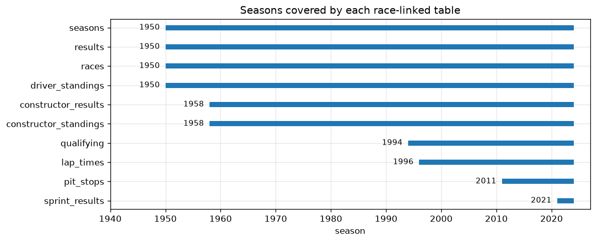

## 2. Data audit and cleaning

**Profile before any change (§2).** Every column of every table was profiled (distinct values, missing share, range, examples), the missing-value markers were counted per column and per season, and the categorical columns were listed with their value counts. Before cleaning, the result rows per race peak at about 39 in the late 1970s–80s, the podium share dips exactly there, and `grid = 0` is a spike of 1,638 rows that mixes drivers who never started with pit-lane starts.

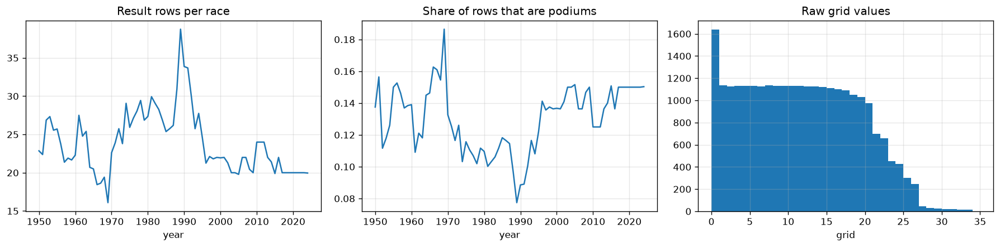

| Problem | How it was detected | Decision |
| --- | --- | --- |
| Missing values stored as the text `\N` in 30 columns, and as empty strings in `q2`/`q3` for 2023–2024 | count per column and season (§2.2); no value is a word pandas would read as missing | read both as missing, nothing else |
| Dates and durations stored as text, durations in three formats (`23.456`, `1:26.572`, `2:05:05.152`) | column profile, format patterns (§2.1, §2.4) | one parser to seconds (matches the `milliseconds` column on all 589,081 laps); dates to `datetime` |
| Spelling variants: `Argentine`/`Argentinian`, `USA`/`United States` | value counts (§2.3) | one canonical name each, asserted (§3.1) |
| One impossible qualifying time (`16:42.640`, 1995 Japanese GP, 10.2× pole) | gap to pole; the next slowest time is 1.45× pole | set to missing; any cutoff between 1.45× and 10.2× gives the same result |
| Team identity splits: 212 constructor ids share 175 Wikipedia links (chassis–engine combinations, renames) | column profile (§2.1) | follow `constructorId`, as the official championship does; documented |
| Validity rules: 13 rules on positions, grid, laps, points, dates, ages, standings | violation counts (§3.2) | every violation traced: shared cars and the Indianapolis 500 (repeated positions), a vacant place after a disqualification (1983 Brazil), Formula 2 cars on a grid (1969 Germany), one entry error in an unused column, a mid-season id change (Marussia 2015) |
| Do the standings agree with the results? | points summed from results and sprints vs `driver_standings` (§3.2) | agree for ≥ 99.3% of rows in every decade and 100% since 1990; the rest is the old "best results only" scoring rule, so the standings are the official championship |
| Primary and foreign keys | uniqueness and reference checks on all 14 tables (§3.2) | all valid; no change |
| 91 extra rows on `(raceId, driverId)`: 85 shared drives, 1950–1978 | natural-key check (§3.2) | keep the row of the car the driver started in; label it a podium if the driver finished on the podium in any car (rule D). Four rules compared: keeping the best result takes the grid slot of the wrong car in 68 of 85 pairs; keeping only the own car's result loses 17 credited podiums (§3.3) |
| `grid = 0` mixes 1,563 entries that never started with 72 pit-lane starts | grid histogram and `laps` (§3.4) | keep a row if the driver had a grid slot or completed a lap. Checked with the model (§8.3): removing only `F` (failed to qualify) or nothing scores the same or worse on the same rows, and keeping the non-starters would flag 217 drivers who never raced as pit-lane starts |
| Indianapolis 500 (1950–1960) | driver overlap (§3.4) | dropped: 103 of its 107 drivers never raced another championship race |

Result: 26,759 result rows → 24,724 driver–race rows (podium share 13.6%). No row and no column was dropped because of a missing value; §3.6 maps every column with missing values to what is done with it.

After cleaning, the podium share in every season follows `3 / starters per race`; the dip before 1995 came from the non-starters (§4.1).

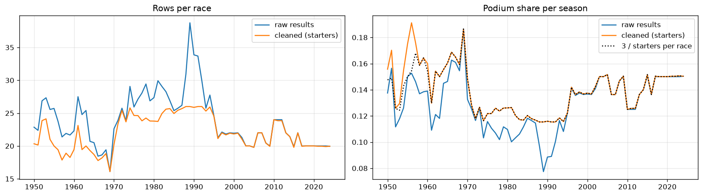

Other findings that shape the later steps:

- **The grid is the strongest signal, and it drifts.** A pole position converted to a podium 53% of the time in 1950–69 and 81% in 2014–24 (§4.2). Per technical era, the grid's ROC-AUC rose from 0.84–0.86 (1958–1988) to 0.89–0.93 (since 1989); 2011–2013, when DRS arrived, is slightly less grid-dominated than 2009–2010 on two of three measures.
- **Qualifying coverage is patchy.** There is no qualifying data before 1994, it is complete in 1994–95, covers only 6–59% of starters in 1996–2002, and is complete from 2003 on (§4.3).
- **Reliability changed.** About half of the starters finished a race until the 1990s, against 86% in the 2020s (§4.4).

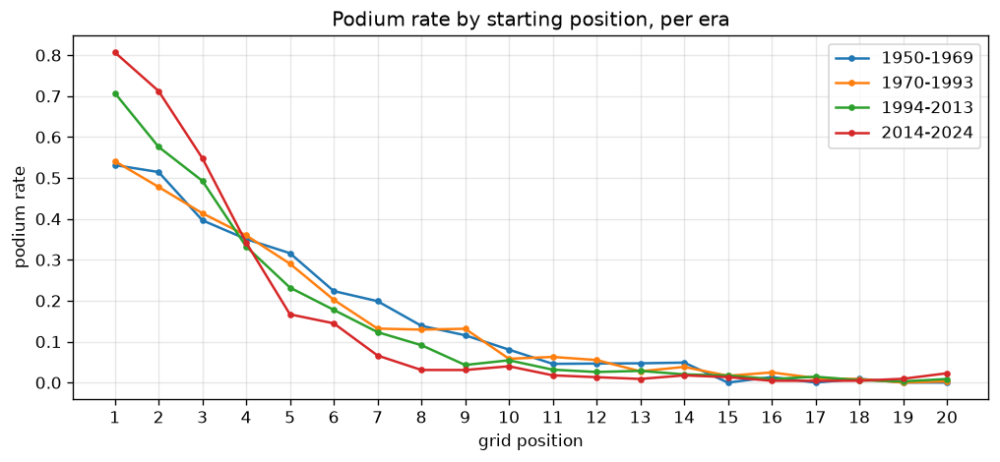

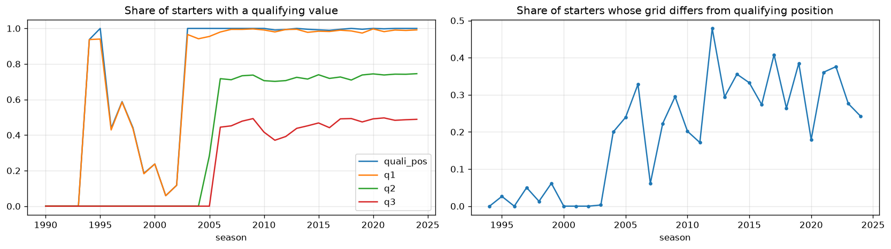

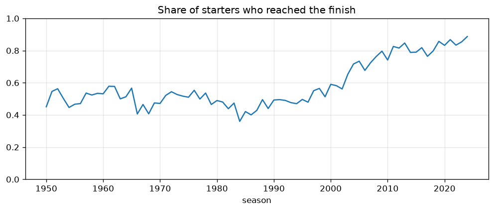

## 3. Data-engineering questions

### Q1. Which circuits convert a front-row start into a podium most often, and does the ranking change after 2014?

**Grain:** one driver starting from the front row (grid 1–2) at one race. **Joins:** results → races → circuits, plus qualifying. **Missingness:** grid is complete; the qualifying definition only exists from 1994 and is analysed separately. **Periods:** 1950–2013 and 2014–2024 ("after the 2014 hybrid era" read as from 2014 on; 2022–2024 alone has at most 3 races per circuit, too few to rank). Circuits need ≥ 10 front-row starts in a period to be ranked.

- Since 2014 the best converters are Suzuka (89%), Yas Marina (86%), Monaco (85%), Barcelona and Spa (82%). Before 2014 the same circuits were led by Suzuka (70%), Hungaroring (68%) and Bahrain (67%).
- The ranking changed completely: the rank correlation between the periods is −0.03. It stays near zero when "before" is limited to 1994–2013 (−0.07), when "after" is limited to the hybrid era 2014–2021 (0.01), and for any minimum of 6–15 front-row starts (−0.13 to 0.06). Hungaroring fell from 2nd to 16th; Monaco rose from 15th to 3rd.
- Conversion rose almost everywhere (56% → 76% overall), in line with better reliability.
- **Qualifying vs grid:** 36 of 986 front-row qualifiers since 1994 did not start from the front row (penalties), and only 31% of them reached the podium. The circuit ranking hardly depends on the definition (rank correlation 0.90).
- With 14–26 front-row starts per circuit since 2014, one podium moves a rate by 4–7 points, so neighbouring ranks are not meaningfully different.

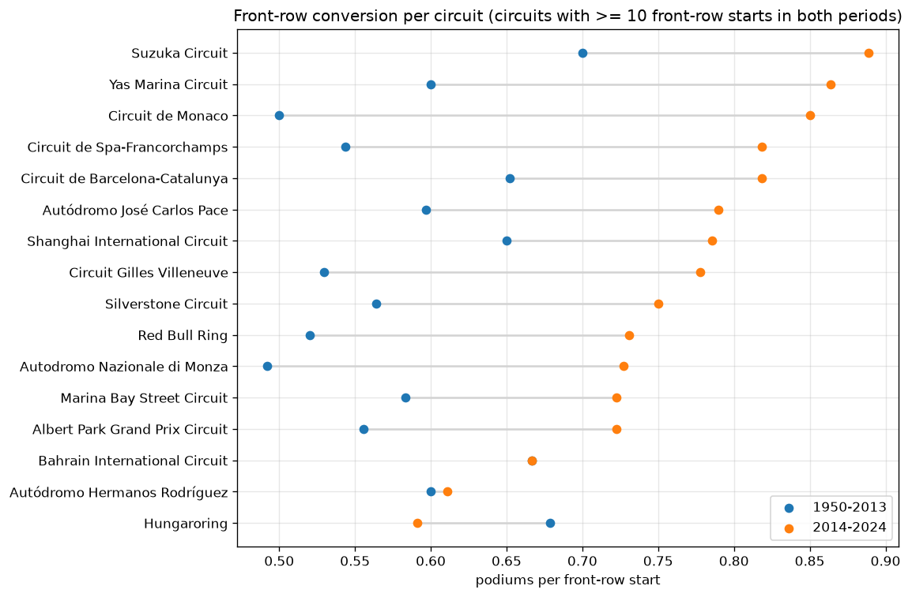

### Q2. Do drivers podium more often at home, after controlling for starting position?

**Grain:** one starter at one race. **Joins:** results → drivers (nationality) and results → races → circuits (country), linked by a hand-made nationality → country map. **Method:** compare home and away drivers within the same grid band, pooled with the Cochran–Mantel–Haenszel test.

- Without control, home drivers podium less often (11.8% vs 13.7%, 1,944 home starts).
- Controlling for the grid: pooled odds ratio 0.95 (95% CI 0.80–1.13, p = 0.58). **No evidence of a home advantage.** The result is the same with exact grid positions (0.96) and with the Indianapolis 500 included (0.96).
- In 1994–2024 alone the odds ratio is 0.70 (CI 0.51–0.95, p = 0.025), i.e. slightly *worse* at home; as one of four variants this is weak evidence.

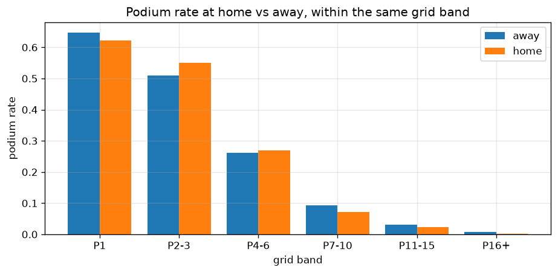

### Q3. Which constructors have the highest mechanical-retirement rate in 2014–2021 vs 2022–2024?

**Grain:** one car that started one race. **Joins:** results → status → constructors, results → races. **Mechanical** = a component failed; the 139 status values were grouped by hand. Following the course staff's clarification, tyre failures, punctures, fire and safety belt count as mechanical and refuelling does not; ambiguous statuses (wing, wheel, damage, the bare "Retired") form an *unclear* group, checked separately. Every constructor is ranked, with a 95% Wilson interval for its rate.

- **2014–2021:** Caterham 23.5% of starts (8/34, its only season), Lotus F1 18.7% (14/75), Toro Rosso 16.5% (40/242); McLaren and Renault 13.5%. The top three's intervals overlap (12–40%, 12–29%, 12–22%), so they cannot be strictly ordered. Mercedes was the most reliable of the teams present in all eight seasons (4.1%).
- **2022–2024:** Alfa Romeo 12.5% (11/88), Alpine 11.0% (15/136), AlphaTauri 8.0% (7/88); most teams are between 2% and 6%.
- Mechanical retirements fell from 9.5% to 5.8% of starts. Counting the unclear statuses as mechanical leaves the leaders unchanged.
- Renamed teams count separately (e.g. Alfa Romeo 2022–23 and Sauber 2024 are the same team: 8.8% together).

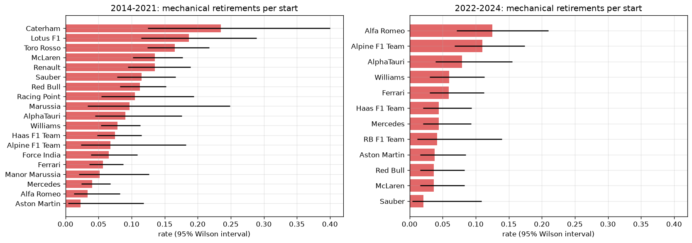

## 4. Features

Every candidate column was screened against the cutoff (§6.1): race results, points, status, laps, pit stops, lap times and same-race standings are excluded. Standings are taken after the previous round; form, circuit history and reliability use only earlier races. Automatic checks confirm this (§6.3): a driver's first start has no form, round 1 has no standings, a first visit to a circuit has no circuit history, and the form of 300 random rows is recomputed by hand from earlier races.

28 candidate features in 11 groups were built (§6.2), including three groups motivated by the F1 introduction and question 3: the driver against the team-mate in the same car, earlier results at the same circuit, and reliability (the driver's recent retirements, the team's recent mechanical failures). Selection used the training seasons only: the single-feature relationship with the podium (§8.1), redundancy (§8.2), and trials (§8.3):

- **Representations:** championship position beats raw points (−0.026, the points system changed) and ties with points share; the Q1 gap beats the gap from each driver's best session (−0.008); a 3-race form window is never beaten and overlaps least with standings and career rate.
- **Forward selection,** in an order computed from the single-feature evidence, with a group kept only if it beats the measured noise level for at least one of the two trial models.
- **Driver form vs constructor form:** they tie on the single-feature evidence and in a head-to-head; the order-free check decides: removing driver form from all groups costs the tree model 0.014 (beyond noise), removing constructor form costs nothing, because the team's strength is already in `con_standing`.
- **Order-free check:** removing one group at a time from all groups shows that the three new groups, experience, field size and home make the models *worse*; all eleven groups together score below the four selected ones.

| Group | Feature | Why it is valid at the cutoff | Evidence |
| --- | --- | --- | --- |
| grid | `grid_pos`, `pit_lane_start` | the starting grid is fixed before the start | strongest signal in every era; removing it costs 0.015–0.023 |
| qualifying | `quali_pos`, `q1_gap_pct` (gap to the fastest Q1 time) | qualifying ends before the race | +0.038 PR-AUC on top of the grid; once standings and form are in it adds little to the trial models (open point for the ablation) |
| standings | `drv_standing`, `con_standing` | championship positions after the previous round | +0.011 (logistic regression), +0.049 (gradient boosting) |
| driver form | podium rate and finishing percentile over the last 3 starts, career podium rate | computed from earlier races only | the tree model loses 0.022 without it |

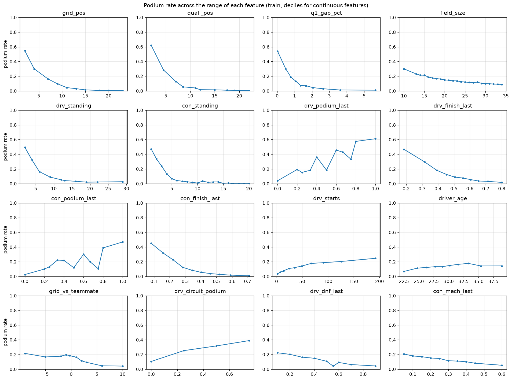

Not selected: raw points and points share, the best-session qualifying gap, `grid − qualifying` (a linear combination of two kept features), constructor form, teammate, circuit history, reliability, experience, field size and the home flag, and sprint results (not leakage, since the sprint runs before the race, but no training season has one).

## 5. Data split

By season: **train 1950–2019 (22,589 rows), validation 2020–2021 (779), test 2022–2024 (1,356).** The model must predict future races from past ones, every race stays in a single split, and the test set is the new 2022 regulation era. The podium rate is 13.4% in train and 15.0% in validation and test. A random split scores the same on the same rows (§7), so the time split is chosen for validity, not for its score.

Known issues of these boundaries and how they are handled (§7): the validation split is small (39 races; 2020 was a 17-race season), so data decisions use three two-season windows (2016–17, 2018–19, 2020–21) and a measured noise level (the spread of scores when 1% of training rows are dropped: 0.005 for logistic regression, 0.011 for gradient boosting); training spans very different eras, so the training window was tested (every shorter window is worse); the test era is new, which is the situation the model faces in use; qualifying coverage and the base rate differ between splits, handled by missing indicators and a validation-chosen threshold.

## 6. Missing values and preprocessing

**Missing values (§3.6, §9.1).** Of the 30 columns with missing values, only `qualifying.q1` feeds a feature; the others are post-race or schedule columns that are never used. What matters are missing *rows*: no qualifying result before 1994 and for 41–94% of starters in 1996–2002, no constructor standings before 1958, no standings at round 1 or in a driver's or team's first race of a season, no form before a driver's first start. In validation and test almost nothing is missing.

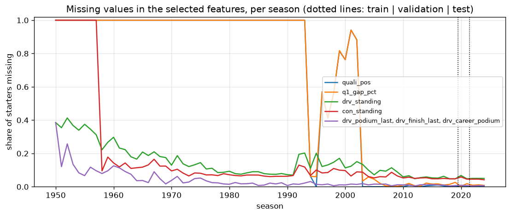

Filling, fitted on the training rows only: the median plus a 0/1 indicator per feature. It beats median only, mean only and filling qualifying with the grid slot; a model-based (iterative) imputer ties with it; dropping training rows with a missing value is clearly worse (−0.014: only 7,384 of 22,589 training rows are complete). Then standard scaling: min-max, robust and no scaling tie for logistic regression, and standard scaling is kept for the regularization penalty and for the neural network. Clipping or log-transforming the qualifying gap and the choice of pit-lane encoding made no difference beyond the noise level.

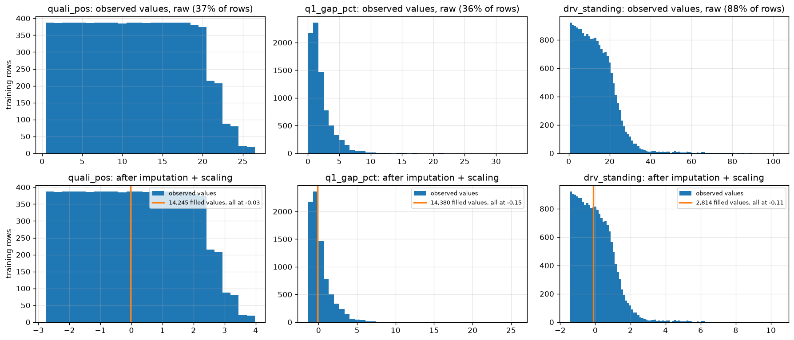

**Preprocessing-order experiments (§9.3)**

| Experiment | Orders compared | Result | Decision |
| --- | --- | --- | --- |
| E1 | fit imputer/scaler after the split (train only) vs before it (all rows) | +0.0003 for the leaky order, far below the noise level | split first: the leaky order uses statistics from the evaluation seasons |
| E2 | impute → scale vs scale → impute | tie (−0.0004); scale → impute leaves imputed features with a standard deviation of 0.61 instead of 1 | impute → scale |
| E3 | build form features after vs before removing non-starters | tie (+0.0001), but 55% of rows get different form values | filter first, so form describes races the driver started |

## 7. Modeling table

`outputs/model_table.csv`: 24,724 rows × 9 features, target `podium`, split column; `outputs/feature_spec.json` lists the features and the 4 groups used by the ablation.

## 8. Models and comparison

*To be completed: baseline, at least two statistical models, a shallow neural network, hyperparameters and threshold chosen on validation, all metrics on train/validation/test, primary metric (recommended: PR-AUC) and secondary metric (ROC-AUC).*

## 9. Ablation and explainability

*To be completed: feature-group ablation (grid, qualifying, standings, driver form); permutation importance and SHAP; one local explanation (LIME or SHAP waterfall). Importance shows what the model relies on; it is not a causal effect.*

## 10. Limitations

The assumptions behind the data decisions are listed, with their evidence, in notebook §17.

- **Qualifying coverage drift:** 63% of the training rows have imputed qualifying features (none before 1994, partial in 1996–2002).
- **Era sensitivity:** the grid-to-podium relationship and reliability changed strongly over 75 years; the test seasons are a new regulation era.
- **Team identity:** a renamed team, or the same chassis with another engine in the early decades, is a new `constructorId`. The constructor standings restart every season, so the selected features lose nothing at a rename between seasons; only cross-season team history (constructor form, not selected) would.
- **Overlapping feature groups:** qualifying, standings and driver form all measure current pace, so removing one costs little while the others are present; the ablation should be read with this in mind.
- **Manual mappings** (status groups, nationality → country) are judgement calls; Q3 includes a sensitivity check.
- **Small validation windows** (about 40 races each): differences below the noise level are treated as ties and decided by a stated rule or on domain grounds.
- *Modeling limitations to be added.*
